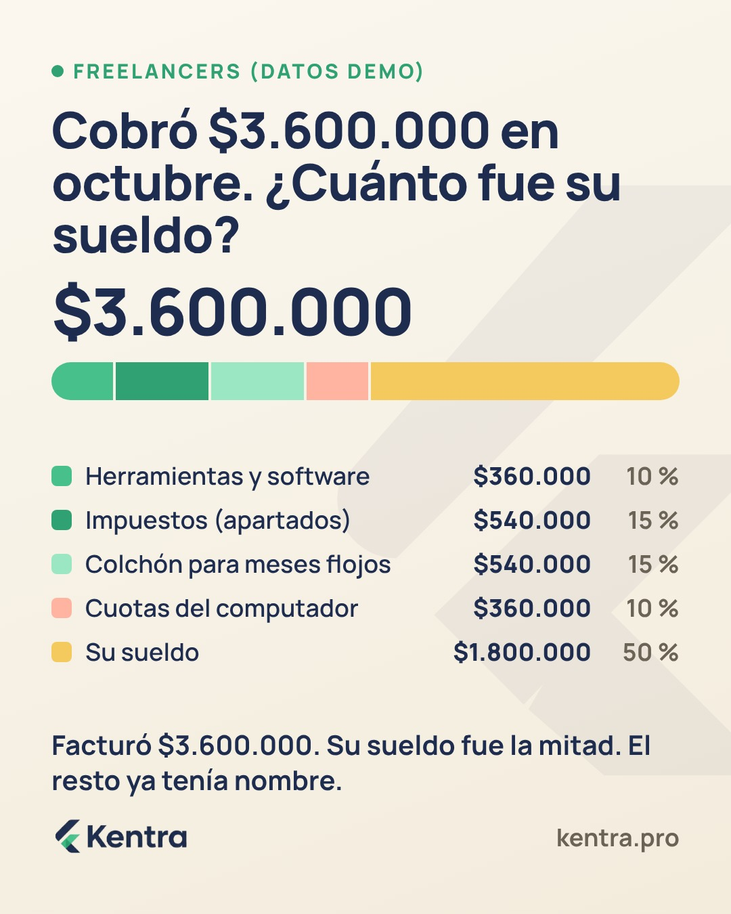

# Próximas publicaciones de Kentra

Se actualiza sola cada hora. Hora de Bogotá. 64 piezas agendadas.

## Martes 20/10

**10:00 — Post** · objeciones · `2026-10-20-04-post`

Descripción

Pasa más de lo que parece: el negocio funciona, pero da miedo abrir las cuentas.

Lo que no se mira no mejora. Empieza con un solo número, cuánto te quedó el mes pasado, y desde ahí decides qué ajustar. Sin juicios y sin jerga.

Kentra te muestra ese número sin fórmulas. 👉 [link de la bio en Instagram / link con UTM en Facebook]

#Kentra #FinanzasParaNegocios #Emprendedores #NegocioPropio

**12:00 — Carrusel** · funcionalidades · `2026-10-20-02-carrusel`

       

Descripción

Un comprobante claro se cobra más rápido.

En este carrusel: los 4 datos que debe llevar todo comprobante de pago (número y fecha, detalle con valores, fecha límite y cómo pagarte) y el paso que casi nadie hace: registrar el cobro cuando llega. Al final, cómo se ve un comprobante de $850.000 en Kentra.

Comprobantes PDF con tu logo en todos los planes. 👉 [link de la bio en Instagram / link con UTM en Facebook]

#Kentra #FinanzasParaNegocios #Emprendedores #Freelancer #Pymes

**18:00 — Post** · verticales · `2026-10-20-05-post`

Descripción

Las apps de domicilio traen pedidos. La pregunta es cuánto te dejan.

En el ejemplo, un restaurante vende $4.000.000 por app en el mes. Comisión ($1.000.000), empaques ($240.000) e insumos ($1.600.000) se llevan $2.840.000: le quedan $1.160.000, el 29 %, y todavía faltan arriendo y nómina.

Separa tus ventas por canal y mira cuál te deja más. 👉 [link de la bio en Instagram / link con UTM en Facebook]

#Kentra #FinanzasParaNegocios #Emprendedores #Restaurantes

**19:00 — Historia** · funcionalidades · `2026-10-20-03-historia`

## Miércoles 21/10

**08:00 — Historia** · kentra-vs-excel · `2026-10-21-01-historia`

**10:00 — Post** · kentra-vs-excel · `2026-10-21-04-post`

Descripción

Una pregunta sencilla. Dos formas muy distintas de responderla.

A la izquierda, lo de siempre: buscar el archivo, filtrar y cruzar los dedos para que la fórmula esté bien. A la derecha, Kentra: cada gasto ya está en su categoría y el total sale solo. Y si prefieres, se lo preguntas a KentrAI.

KentrAI es ilimitado en todos los planes. 👉 [link de la bio en Instagram / link con UTM en Facebook]

#Kentra #FinanzasParaNegocios #Emprendedores #Excel #Pymes

**12:00 — Carrusel** · verticales · `2026-10-21-02-carrusel`

       

Descripción

Si tu precio sale de mirar al salón de enfrente, puede que estés cobrando de menos.

En este carrusel: cómo calcular el precio de un manicure semipermanente en 5 pasos. Insumos $7.000 + pago por servicio $12.000 + gastos fijos $12.000 = costo real $31.000. A $45.000 te quedan $14.000; a $35.000, solo $4.000. Haz la cuenta con tu servicio más pedido.

Kentra suma tus gastos fijos por ti. 👉 [link de la bio en Instagram / link con UTM en Facebook]

#Kentra #FinanzasParaNegocios #Emprendedores #SalonDeBelleza #Precios

**18:00 — Post** · ganancia-real · `2026-10-21-05-post`

Descripción

Ver la caja llena un viernes no dice cuánto ganó el negocio.

La cuenta es una resta: todo lo que entró en el mes menos todo lo que salió, incluidos los gastos pequeños y tu propio sueldo. Lo que queda, eso es ganancia.

Kentra hace esa resta sola con lo que registras. 👉 [link de la bio en Instagram / link con UTM en Facebook]

#Kentra #FinanzasParaNegocios #Emprendedores #GananciaReal #Pymes

**19:00 — Historia** · funcionalidades · `2026-10-21-03-historia`

## Jueves 22/10

**08:00 — Historia** · objeciones · `2026-10-22-01-historia`

**10:00 — Post** · objeciones · `2026-10-22-04-post`

Descripción

Muchos negocios pequeños no emiten facturas. Igual compran, venden, pagan y cobran todos los días.

Para saber si ganas no necesitas facturas: necesitas anotar lo que entra y lo que sale, cada cosa en su categoría. Con eso ya ves cuánto te quedó cada mes.

En Kentra registras ingresos y gastos desde el celular. 👉 [link de la bio en Instagram / link con UTM en Facebook]

#Kentra #FinanzasParaNegocios #Emprendedores #NegocioPropio #Pymes

**12:00 — Carrusel** · educacion · `2026-10-22-02-carrusel`

        

Descripción

Con varias deudas, el error más común es pagar un poco de cada una sin plan.

En este carrusel: un orden en 6 pasos con el ejemplo de una panadería que debe $5.200.000. Primero lo que frena la operación, después la deuda más cara (la tarjeta le cobra $60.000 al mes en intereses) y un monto fijo que sale de lo que te quedó, no de lo que vendiste.

Kentra te avisa antes de cada vencimiento. 👉 [link de la bio en Instagram / link con UTM en Facebook]

#Kentra #FinanzasParaNegocios #Emprendedores #Deudas #Pymes

**18:00 — Post** · funcionalidades · `2026-10-22-05-post`

Descripción

Si cada mes clasificas a mano los mismos movimientos, ese trabajo se puede automatizar.

Con las reglas de categorización automática le dices a Kentra una sola vez que la transportadora va a Envíos y la pasarela a Ventas. Cuando subes el extracto del banco, cada movimiento cae en su categoría, como en la pantalla.

Disponible en los planes Pro y Business. 👉 [link de la bio en Instagram / link con UTM en Facebook]

#Kentra #FinanzasParaNegocios #Emprendedores #TiendaOnline

**19:00 — Historia** · ganancia-real · `2026-10-22-03-historia`

## Viernes 23/10

**08:00 — Historia** · precio · `2026-10-23-01-historia`

**10:00 — Post** · precio · `2026-10-23-04-post`

Descripción

$15 al mes para dejar de adivinar cuánto gana tu negocio.

El plan Básico incluye ingresos y gastos por categoría, ganancia real del mes, comprobantes PDF con tu logo, alertas de pagos y KentrAI ilimitado. Acceso inmediato después del pago, y si pagas el año ahorras 45 %.

Sin plantillas y sin fórmulas. 👉 [link de la bio en Instagram / link con UTM en Facebook]

#Kentra #FinanzasParaNegocios #Emprendedores #Pymes

**12:00 — Carrusel** · funcionalidades · `2026-10-23-02-carrusel`

      

Descripción

Llevar dos negocios en la misma libreta es la forma más rápida de no saber cuál gana.

En este carrusel: por qué separarlos (un café que gana $1.450.000 puede esconder una tienda que pierde $300.000), cómo repartir los gastos compartidos y cómo se ve en Kentra, cada negocio con sus números y su moneda.

Plan Pro: hasta 2 negocios por $20/mes. 👉 [link de la bio en Instagram / link con UTM en Facebook]

#Kentra #FinanzasParaNegocios #Emprendedores #NegocioPropio #Pymes

**18:00 — Post** · educacion · `2026-10-23-05-post`

Descripción

Un pedido grande emociona. También puede dejarte sin dinero para operar.

Antes de aceptarlo, revisa cuatro cosas: si puedes pagar los insumos antes de cobrar, cuándo te pagan exactamente, cuánto te deja después de todos los gastos y qué dejas de atender mientras lo haces. Guárdalo para tu próximo pedido.

Kentra te muestra cuánto te deja cada mes. 👉 [link de la bio en Instagram / link con UTM en Facebook]

#Kentra #FinanzasParaNegocios #Emprendedores #Pymes

**19:00 — Historia** · funcionalidades · `2026-10-23-03-historia`

## Sábado 24/10

**08:00 — Historia** · ganancia-real · `2026-10-24-01-historia`

**10:00 — Post** · ganancia-real · `2026-10-24-04-post`

Descripción

Sin juzgar: ¿cuál es tu caso? 👇

¿Cada cuánto miras cuánto entró, cuánto salió y cuánto te quedó? 1) cada semana, 2) cada mes o 3) solo cuando algo sale mal. Responde con el número en los comentarios.

Cuando todo está registrado, mirarlo cada semana toma minutos. 👉 [link de la bio en Instagram / link con UTM en Facebook]

#Kentra #FinanzasParaNegocios #Emprendedores #NegocioPropio

**12:00 — Carrusel** · educacion · `2026-10-24-02-carrusel`

       

Descripción

La mercancía que no se vende no es un adorno: es dinero que ya pagaste y no ha vuelto.

En este carrusel: cómo calcular cuánto dinero tienes en bodega, encontrar lo que lleva 90 días sin venderse y recuperarlo. En el ejemplo, 72 prendas quietas son $1.800.000; vendidas a $30.000 recuperas ese dinero y aún ganas $360.000.

Kentra tiene módulo de inventario en los planes Pro y Business. 👉 [link de la bio en Instagram / link con UTM en Facebook]

#Kentra #FinanzasParaNegocios #Emprendedores #TiendaOnline #Inventario

**18:00 — Post** · kentra-vs-excel · `2026-10-24-05-post`

Descripción

La venta pasa en la calle; el archivo de Excel se queda en el computador de la casa.

Con Kentra registras el gasto o el cobro en el momento, desde el celular, y lo ves igual en el computador. Un solo lugar, siempre al día y con acceso seguro en todos tus dispositivos.

Desde $15/mes. 👉 [link de la bio en Instagram / link con UTM en Facebook]

#Kentra #FinanzasParaNegocios #Emprendedores #Excel #Pymes

**19:00 — Historia** · objeciones · `2026-10-24-03-historia`

## Domingo 25/10

**08:00 — Historia** · funcionalidades · `2026-10-25-01-historia`

**10:00 — Post** · ganancia-real · `2026-10-25-04-post`

Descripción

No hace falta revisarlo todo el domingo. Basta con un número.

En la pantalla, un estudio creativo a 25 de octubre: entraron $6.200.000, salieron $4.480.000 y le quedan $1.720.000. Ese número te dice si vas bien antes de que termine el mes.

Kentra lo calcula solo con lo que registras. 👉 [link de la bio en Instagram / link con UTM en Facebook]

#Kentra #FinanzasParaNegocios #Emprendedores #Freelancer

**12:00 — Carrusel** · educacion · `2026-10-25-02-carrusel`

       

Descripción

Recortar a ciegas es fácil: se corta lo primero que se ve, aunque sea lo que trae ventas.

En este carrusel: 3 grupos para ordenar tus gastos y el ejemplo de una cafetería que libera $545.000 al mes sin vender más: $145.000 negociando insumos y $400.000 en gastos que no usaba. En un año son $6.540.000.

Kentra te muestra cada gasto en su categoría. 👉 [link de la bio en Instagram / link con UTM en Facebook]

#Kentra #FinanzasParaNegocios #Emprendedores #ControlDeGastos #Pymes

**18:00 — Post** · funcionalidades · `2026-10-25-05-post`

Descripción

Tú atiendes clientes. Kentra se encarga de las cuentas.

Cuando marcas un cobro, queda registrado solo; antes de que venza un pago o una cuota, te avisa; y con cada movimiento suma tus gastos por categoría y actualiza tu ganancia real del mes.

Desde $15/mes, con acceso inmediato. 👉 [link de la bio en Instagram / link con UTM en Facebook]

#Kentra #FinanzasParaNegocios #Emprendedores #Pymes

**19:00 — Historia** · ganancia-real · `2026-10-25-03-historia`

## Lunes 26/10

**08:00 — Historia** · funcionalidades · `2026-10-26-01-historia`

**10:00 — Post** · funcionalidades · `2026-10-26-04-post`

Descripción

Un 12 % en insumos no se nota en la cocina. Se nota a fin de mes.

En la pantalla, un restaurante en octubre: insumos $3.810.000 (12 % por encima de lo previsto), nómina $2.200.000, arriendo $1.600.000, servicios $420.000 y domicilios $380.000. La barra roja avisa sola cuando una categoría se pasa.

Control por categorías con alertas, desde $15/mes. 👉 [link de la bio en Instagram / link con UTM en Facebook]

#Kentra #FinanzasParaNegocios #Emprendedores #Restaurantes #ControlDeGastos

**12:00 — Carrusel** · verticales · `2026-10-26-02-carrusel`

       

Descripción

Los insumos suben. Tu carta, no. Y el que paga la diferencia eres tú.

En este carrusel, la cuenta con un plato de $28.000: con insumos 12 % más caros pasa de dejarte $4.800 a $3.450. En 1.200 platos al mes son $1.620.000 menos. Subir el plato a $29.500 (un 5 %) recupera la ganancia.

Kentra te avisa cuando una categoría se pasa del presupuesto. 👉 [link de la bio en Instagram / link con UTM en Facebook]

#Kentra #FinanzasParaNegocios #Emprendedores #Restaurantes #Precios

**18:00 — Post** · kentra-vs-excel · `2026-10-26-05-post`

Descripción

El lunes se nota dónde llevas las cuentas.

A la izquierda, la versión Excel: buscar el archivo, pasar a mano las ventas del fin de semana y descubrir que una fórmula se rompió. A la derecha, la versión Kentra: abres la app, lo del fin de semana ya está registrado y la ganancia del mes se calculó sola.

Desde $15/mes, en celular y computador. 👉 [link de la bio en Instagram / link con UTM en Facebook]

#Kentra #FinanzasParaNegocios #Emprendedores #Excel #Pymes

**19:00 — Historia** · ganancia-real · `2026-10-26-03-historia`

## Martes 27/10

**08:00 — Historia** · objeciones · `2026-10-27-01-historia`

**10:00 — Post** · objeciones · `2026-10-27-04-post`

Descripción

Un pedido en el chat, un gasto en las notas, un pago en la foto del comprobante. Todo existe, pero nada suma.

Lo que se ve: la objeción que más escuchamos y lo que pasa con ella. Cuando cada venta vive en un lugar distinto, a fin de mes no hay forma de saber cuánto quedó.

En Kentra registras ingresos y gastos desde el celular y ves los tres números en una pantalla. 👉 [link de la bio en Instagram / link con UTM en Facebook]

#Kentra #FinanzasParaNegocios #Emprendedores #NegocioPropio #Pymes

**12:00 — Carrusel** · funcionalidades · `2026-10-27-02-carrusel`

       

Descripción

Lo caro no es el gasto. Es enterarte tarde.

En este carrusel, 5 avisos que Kentra manda solos: un pago a proveedor que vence mañana, una categoría que se pasó del presupuesto, una cuota de la tarjeta por vencer, una nota con fecha límite y un cobro que se registra solo cuando lo marcas como cobrado.

Todos los avisos en una lista, en todos los planes. 👉 [link de la bio en Instagram / link con UTM en Facebook]

#Kentra #FinanzasParaNegocios #Emprendedores #Pymes #NegocioPropio

**18:00 — Post** · verticales · `2026-10-27-05-post`

Descripción

Una semana de pedidos es una semana de ventas. No una semana de ganancia.

En la imagen, una pastelería con los pedidos de Halloween: vendió $3.200.000; insumos, empaques y entregas sumaron $2.270.000; le quedaron $930.000, el 29 %. Ese porcentaje es el que decide cuánto vale aceptar más pedidos en diciembre.

Kentra te muestra lo que entró, lo que salió y lo que te quedó. 👉 [link de la bio en Instagram / link con UTM en Facebook]

#Kentra #FinanzasParaNegocios #Emprendedores #Pastelería #Pymes

**19:00 — Historia** · funcionalidades · `2026-10-27-03-historia`

## Miércoles 28/10

**08:00 — Historia** · ganancia-real · `2026-10-28-01-historia`

**10:00 — Post** · ganancia-real · `2026-10-28-04-post`

Descripción

Mejor que el mes pasado se siente. Saberlo con un número es otra cosa.

En la pantalla, una tienda online en octubre: entraron $7.400.000, salieron $5.620.000 y el saldo neto es $1.780.000, un 24 % de margen y un 18 % más que en septiembre. La etiqueta verde compara el mes con el anterior sin que armes nada.

Tu ganancia real del mes, en una pantalla. 👉 [link de la bio en Instagram / link con UTM en Facebook]

#Kentra #FinanzasParaNegocios #Emprendedores #TiendaOnline #GananciaReal

**12:00 — Carrusel** · educacion · `2026-10-28-02-carrusel`

       

Descripción

Diciembre vende más. Pero la mercancía se paga en noviembre.

En este carrusel, 4 cuentas antes de hacer el pedido grande: cuánto vendiste el diciembre pasado, cuánto creciste este año, cuánto dinero se va a la bodega y cuánto puedes pagar sin dejar noviembre sin aire. En el ejemplo, una tienda necesita 370 unidades ($11.780.000) y hoy solo puede pagar $4.800.000: compra en dos tandas.

Kentra te muestra el saldo neto al día. 👉 [link de la bio en Instagram / link con UTM en Facebook]

#Kentra #FinanzasParaNegocios #Emprendedores #TiendaOnline #Inventario

**18:00 — Post** · ganancia-real · `2026-10-28-05-post`

Descripción

El saldo se ve lindo el 28. El 5 del mes siguiente, ya no tanto.

Lo que dice la imagen: el dinero de la cuenta todavía tiene dueños pendientes (el arriendo, el proveedor, la cuota). Lo tuyo es lo que queda después de restarlos, y eso casi nunca es lo que muestra el banco.

Kentra separa lo que entró, lo que salió y lo que debes. 👉 [link de la bio en Instagram / link con UTM en Facebook]

#Kentra #FinanzasParaNegocios #Emprendedores #GananciaReal #Pymes

**19:00 — Historia** · educacion · `2026-10-28-03-historia`

## Jueves 29/10

**08:00 — Historia** · funcionalidades · `2026-10-29-01-historia`

**10:00 — Post** · funcionalidades · `2026-10-29-04-post`

Descripción

El extracto del banco ya tiene todos tus movimientos. Lo que falta es que alguien los organice.

En la pantalla: subes el archivo de octubre (CSV o Excel) y Kentra detecta 47 movimientos, los separa en ingresos y gastos y les pone categoría: insumos, ventas, arriendo, comisiones. Tú solo revisas.

Importación con IA en los planes Pro y Business. 👉 [link de la bio en Instagram / link con UTM en Facebook]

#Kentra #FinanzasParaNegocios #Emprendedores #Pymes #NegocioPropio

**12:00 — Carrusel** · educacion · `2026-10-29-02-carrusel`

       

Descripción

Si cobras todo al final, el proyecto lo financias tú.

En este carrusel, el caso de un estudio de diseño con un proyecto de $3.000.000: sin anticipo pone $1.800.000 de su bolsillo durante 10 semanas; con un 50 % al firmar y dos hitos (30 % y 20 %), nunca pone más de $300.000. Cada hito con su comprobante, su fecha límite y su recordatorio.

Kentra hace el comprobante PDF con tu logo y registra el cobro cuando lo marcas. 👉 [link de la bio en Instagram / link con UTM en Facebook]

#Kentra #FinanzasParaNegocios #Emprendedores #Freelancer #Creativos

**18:00 — Post** · precio · `2026-10-29-05-post`

Descripción

Lo que viste esta semana (el extracto que se organiza solo, las cuotas con su calendario) vive en el plan Pro.

En la imagen: Plan Pro por $20 al mes, con importación bancaria y de facturas con IA, módulo de créditos y cuotas, inventario, reglas de categorización automática, hasta 2 negocios y 1 usuario extra. Es el plan que más eligen.

Acceso inmediato y cancelas cuando quieras. Pagando el año ahorras 45 %. 👉 [link de la bio en Instagram / link con UTM en Facebook]

#Kentra #FinanzasParaNegocios #Emprendedores #Pymes #NegocioPropio

**19:00 — Historia** · objeciones · `2026-10-29-03-historia`

## Viernes 30/10

**08:00 — Historia** · ganancia-real · `2026-10-30-01-historia`

**10:00 — Post** · funcionalidades · `2026-10-30-04-post`

Descripción

El cierre no debería ser una sorpresa el día 31.

En la pantalla, una cafetería a 30 de octubre: saldo neto $1.900.000 (19,4 % de margen), ingresos $9.800.000, gastos $7.900.000 y, arriba de todo, una alerta: $640.000 por cobrar vencidos. Dos días para cobrarlos antes de cerrar el mes.

Kentra te muestra el mes y lo que falta, sin esperar al 31. 👉 [link de la bio en Instagram / link con UTM en Facebook]

#Kentra #FinanzasParaNegocios #Emprendedores #CierreDeMes #Pymes

**12:00 — Carrusel** · ganancia-real · `2026-10-30-02-carrusel`

       

Descripción

Cerrar el mes no es un domingo entero con la calculadora. Son 5 pasos.

En este carrusel, el cierre de octubre de una cafetería: registrar lo que falta, cobrar los $640.000 pendientes, apartar los $3.000.000 que ya debe pagar en noviembre, mirar los tres números (entró $9.800.000, salió $7.900.000, quedó $1.900.000) y compararlos con septiembre: +31 %.

En Kentra el cierre ya está hecho cuando llegas al 31. 👉 [link de la bio en Instagram / link con UTM en Facebook]

#Kentra #FinanzasParaNegocios #Emprendedores #CierreDeMes #Restaurantes

**18:00 — Post** · kentra-vs-excel · `2026-10-30-05-post`

Descripción

El cierre de mes tiene dos versiones.

Lo que dice la imagen: en una hoja de cálculo cerrar octubre es juntar archivos, revisar fórmulas y cuadrar diferencias durante un fin de semana. En Kentra, lo que registraste en el mes ya está sumado, restado y comparado con septiembre cuando abres la app.

Cálculos automáticos, reportes listos en segundos. 👉 [link de la bio en Instagram / link con UTM en Facebook]

#Kentra #FinanzasParaNegocios #Emprendedores #Excel #CierreDeMes

**19:00 — Historia** · ganancia-real · `2026-10-30-03-historia`

## Sábado 31/10

**08:00 — Historia** · educacion · `2026-10-31-01-historia`

**10:00 — Post** · educacion · `2026-10-31-04-post`

Descripción

Vender más es fácil de ver. Dónde se fue lo que vendiste, no tanto.

En la pantalla, los gastos de octubre de una cafetería, categoría por categoría: insumos $3.350.000 (12 % sobre el presupuesto y 16 % más que en septiembre), nómina $1.650.000 (+10 % por un turno extra), domicilios $395.000 (−8 %). Las barras rojas señalan dónde mirar.

Gastos por categoría, con presupuesto y alerta. 👉 [link de la bio en Instagram / link con UTM en Facebook]

#Kentra #FinanzasParaNegocios #Emprendedores #ControlDeGastos #Restaurantes

**12:00 — Carrusel** · ganancia-real · `2026-10-31-02-carrusel`

       

Descripción

Un mes solo es un número. Dos meses son una tendencia.

En este carrusel, octubre contra septiembre en una cafetería: vendió 17 % más, los insumos subieron 16 %, la nómina 10 % y los domicilios bajaron 8 %. La ganancia pasó de $1.450.000 a $1.900.000 (+31 %) y el margen de 17,3 % a 19,4 %. Al final, una sola decisión para noviembre.

Kentra compara el mes con el anterior sin que armes tablas. 👉 [link de la bio en Instagram / link con UTM en Facebook]

#Kentra #FinanzasParaNegocios #Emprendedores #CierreDeMes #GananciaReal

**18:00 — Post** · objeciones · `2026-10-31-05-post`

Descripción

Saber que ganas poco no es lo mismo que saber por qué.

Lo que dice la imagen: el número no está para asustarte, está para señalar. Un gasto que creció, un producto mal cotizado, un cliente que paga tarde. Cuando lo ves, hay algo concreto que cambiar; cuando no, solo queda trabajar más.

Kentra te muestra dónde está la diferencia. 👉 [link de la bio en Instagram / link con UTM en Facebook]

#Kentra #FinanzasParaNegocios #Emprendedores #NegocioPropio #Pymes

**19:00 — Historia** · educacion · `2026-10-31-03-historia`

## Domingo 1/11

**08:00 — Historia** · ganancia-real · `2026-11-01-01-historia`

**10:00 — Post** · ganancia-real · `2026-11-01-04-post`

Descripción

Octubre cerró. Estos son los tres números que importan.

En la imagen, una cafetería: entraron $9.800.000, salieron $7.900.000 (insumos $3.350.000, arriendo $1.800.000, nómina $1.650.000 y otros $1.100.000) y quedaron $1.900.000. De ese número sale el sueldo del dueño, pero no todo: una parte vuelve al negocio.

Kentra te da los tres números el día 1, sin calculadora. 👉 [link de la bio en Instagram / link con UTM en Facebook]

#Kentra #FinanzasParaNegocios #Emprendedores #GananciaReal #Restaurantes

**12:00 — Carrusel** · educacion · `2026-11-01-02-carrusel`

       

Descripción

Si tu sueldo es «lo que sobre», hay meses en los que no cobras.

En este carrusel, cómo fijar el sueldo del dueño con los números de octubre de una cafetería: de los $1.900.000 que quedaron, aparta el colchón ($380.000) y el abono al crédito ($400.000); quedan $1.120.000, así que el sueldo se fija en $1.100.000 como un gasto más. ¿Quieres $1.500.000? Faltan $400.000: $2.000.000 más en ventas o 12 % menos en insumos.

En Kentra, tu sueldo es una categoría más. 👉 [link de la bio en Instagram / link con UTM en Facebook]

#Kentra #FinanzasParaNegocios #Emprendedores #SueldoDelDueño #Pymes

**18:00 — Post** · ganancia-real · `2026-11-01-05-post`

Descripción

Un negocio que no le paga a su dueño no está ganando. Está aguantando.

Lo que dice la imagen: tu sueldo va primero, registrado como un gasto fijo cada mes. Lo que quede después de pagarlo es la ganancia real del negocio, no antes.

En Kentra creas la categoría, la registras el día 1 y ves lo que queda. Desde $15/mes. 👉 [link de la bio en Instagram / link con UTM en Facebook]

#Kentra #FinanzasParaNegocios #Emprendedores #SueldoDelDueño #NegocioPropio

**19:00 — Historia** · ganancia-real · `2026-11-01-03-historia`

## Últimas publicadas

- martes 20/10 · 08:00 · Historia `2026-10-20-01-historia` · IG ✓ · FB ✓
- lunes 19/10 · 19:00 · Historia `2026-10-19-03-historia` · IG ✓ · FB ✓
- lunes 19/10 · 18:00 · Post `2026-10-19-05-post` · IG ✓ · FB ✓
- lunes 19/10 · 12:00 · Carrusel `2026-10-19-02-carrusel` · IG ✓ · FB ✓
- lunes 19/10 · 10:00 · Post `2026-10-19-04-post` · IG ✓ · FB ✓
- lunes 19/10 · 08:00 · Historia `2026-10-19-01-historia` · IG ✓ · FB ✓
