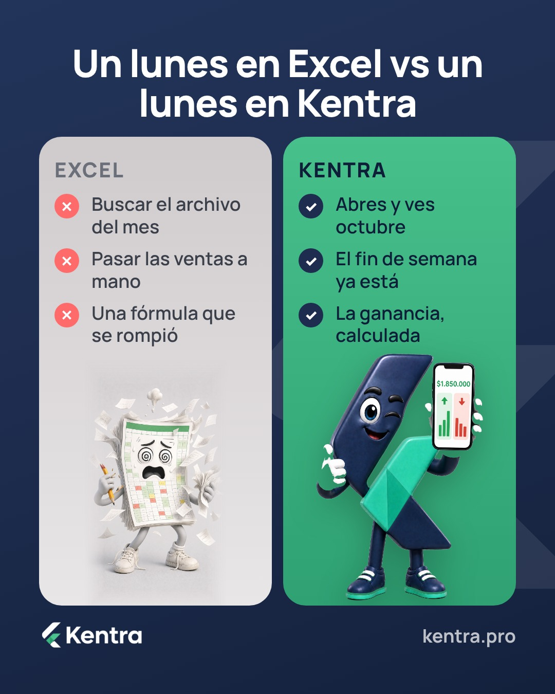

# Próximas publicaciones de Kentra

Se actualiza sola cada hora. Hora de Bogotá. 2 piezas agendadas.

## Domingo 25/10

**19:00 — Historia** · objeciones · `2026-10-25-03-historia`

## Lunes 26/10

**18:00 — Post** · kentra-vs-excel · `2026-10-26-05-post`

Descripción

El lunes se nota dónde llevas las cuentas.

A la izquierda, la versión Excel: buscar el archivo, pasar a mano las ventas del fin de semana y descubrir que una fórmula se rompió. A la derecha, la versión Kentra: abres la app, lo del fin de semana ya está registrado y la ganancia del mes se calculó sola.

Desde $15/mes, en celular y computador. 👉 [link de la bio en Instagram / link con UTM en Facebook]

#Kentra #FinanzasParaNegocios #Emprendedores #Excel #Pymes

## Últimas publicadas

- domingo 25/10 · 18:00 · Post `2026-10-25-05-post` · IG ✓ · FB ✓
- domingo 25/10 · 08:00 · Historia `2026-10-25-01-historia` · IG ✓ · FB ✓
- sábado 24/10 · 19:00 · Historia `2026-10-24-03-historia` · IG ✓ · FB ✓
- sábado 24/10 · 18:00 · Post `2026-10-24-05-post` · IG ✓ · FB ✓
- sábado 24/10 · 12:00 · Carrusel `2026-10-24-02-carrusel` · IG ✓ · FB ✓
- sábado 24/10 · 10:00 · Post `2026-10-24-04-post` · IG ✓ · FB ✓
